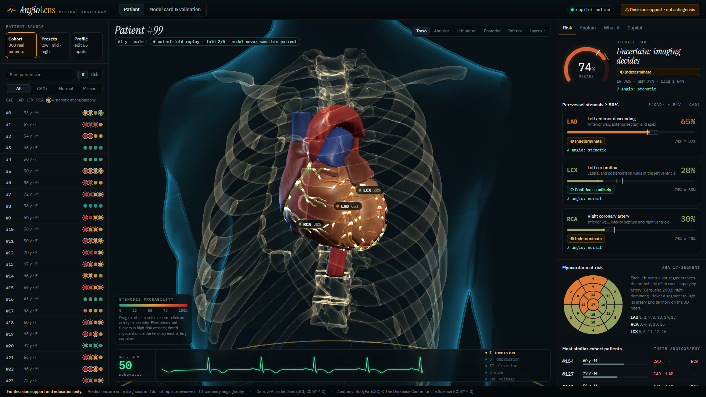
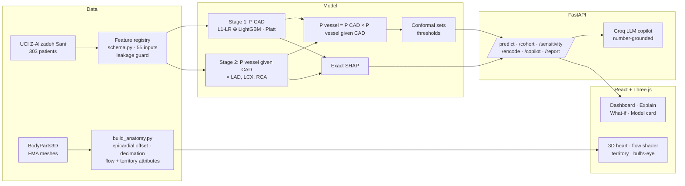

# AngioLens · a virtual angiogram

**Coronary artery disease and per-vessel stenosis prediction, explained exactly with SHAP and mapped onto a real 3D heart.**
Multimodal AI Hackathon 2026 · Track A: Cardiovascular Risk Visualization & Prediction · Team **Random Forest Rangers** (Arnav Joshi)



> **Decision-support and educational prototype. Not a medical device and not a diagnosis.** It does not replace invasive or
> CT coronary angiography or clinical judgement.

- 📄 **Technical report (5 pages):** [`docs/AngioLens_Technical_Report.pdf`](docs/AngioLens_Technical_Report.pdf)
- 🎬 **Demo video (6 min):** https://youtu.be/R_DU726G0Zs
- 🧪 **Validation:** 10×5 repeated nested cross-validation · 20 automated tests

---

## Why

A risk score says *how likely* coronary disease is. A cardiologist also needs *where*. Invasive angiography answers that,
but only after an invasive procedure. AngioLens answers it as far as routine data allows: it predicts overall CAD and
≥50 % stenosis of the **LAD, LCX and RCA** from history, examination, ECG, labs and echo. It explains each prediction
exactly, shows it on the arteries and myocardium of a 3D heart, and states plainly when it does not know.

## Results (out-of-sample, 10×5 repeated nested CV, n = 303)

| Target | ROC-AUC (95 % CI) | Brier | Accuracy* | Precision* | Recall* | Specificity* | F1* | 90 % conformal coverage |
|---|---|---|---|---|---|---|---|---|
| Overall CAD | **0.927** (0.89–0.96) | 0.094 | 86 % | 94 % | 86 % | 86 % | 0.90 | 90.6 % |
| LAD stenosis | **0.842** (0.80–0.88) | 0.155 | 78 % | 80 % | 83 % | 70 % | 0.81 | 89.3 % |
| LCX stenosis | **0.737** (0.68–0.79) | 0.199 | 66 % | 55 % | 79 % | 58 % | 0.65 | 89.2 % |
| RCA stenosis | **0.712** (0.64–0.78) | 0.203 | 64 % | 51 % | 75 % | 57 % | 0.61 | 88.6 % |

\* at the operating threshold chosen by Youden's J inside the inner CV. Against L1-LR, LightGBM, random forest and a direct
per-vessel blend on identical splits, AngioLens matches the best discrimination, has the best or tied-best Brier score on
every target, and is the only model with **100 % anatomically coherent output**. Direct per-vessel models produce
P(vessel) > P(CAD) in about 21 % of patients. Full tables, ROC, calibration and decision curves are in the app's
*Model card* tab and the report.

## What makes it different

| | |
|---|---|
| **Hierarchical, coherent model** | CAD means "any vessel ≥ 50 %", so we model `P(vessel) = P(CAD) × P(vessel \| CAD)`. A vessel can never be riskier than the disease it belongs to. |
| **Exact explanations** | Each stage is an L1-logistic + LightGBM blend in log-odds followed by Platt scaling. Every step is affine, so linear SHAP + TreeSHAP add up **exactly** to the calibrated probability (unit-tested to 1e-6). |
| **Knows when it doesn't know** | Mondrian conformal prediction (α = 0.10) labels each output *confident* or *indeterminate*. Coverage holds out-of-sample. |
| **Honest cohort replay** | Browse all 303 real patients; each is explained by the cross-validation model that **never saw them**, next to their real angiography result, mistakes included. |
| **A heart that means something** | Real BodyParts3D anatomy (FMA-selected LAD/LCX/RCA trees), ventricles corrected to the epicardium, contrast flow that slows in risky arteries, myocardial territory at risk, AHA 17-segment bull's-eye, heartbeat and ECG from the patient's own data. 60 fps on integrated graphics. |
| **Grounded LLM copilot** | Explains results for clinicians or patients, in English or हिन्दी, by text or voice. Every number it writes is machine-checked against the model output; the rest is declined. Works offline with a template fallback. |

## Features

- **3D virtual angiogram** (React Three Fiber): rotate, zoom and fly to anterior, left-lateral, posterior and inferior views. Click an artery to isolate it, or click any point on the myocardium to see which arteries supply it. Toggle torso, bones, lungs, great vessels, flow, territory and labels.
- **Clinical dashboard:** CAD gauge (probability, model range, threshold, conformal status), per-vessel cards with the P(CAD) × P(v | CAD) decomposition and angiography ground truth, and the AHA 17-segment map linked to the 3D view.
- **Explain:** two-stage SHAP waterfalls ("is there CAD?" / "where?"), domain totals, and a physiological breakdown of all 55 inputs against adult reference ranges.
- **What-if:** counterfactual probes, risk-factor targets with explicit confounding warnings, and per-patient sensitivity curves for any feature.
- **Input workflow:** 303 cohort patients, low / intermediate / high presets, a 55-field editor with live re-prediction, and JSON or CSV import (including raw UCI column format) and export.
- **Model card:** every validation number with CIs, model comparison, ROC, calibration, decision curves, conformal coverage, and global importance.
- **One-page PDF report** per patient, with the bull's-eye, factors, narrative and disclaimer.

## Quick start

**Prerequisites:** Python **3.11 or 3.12** and a modern browser (Chrome, Edge or Firefox). No GPU and no Node.js are needed;
the trained model, the 3D asset and the built web app ship in the repository.

```bash
git clone https://github.com/Arnav020/AngioLens.git
cd AngioLens
python -m venv .venv
# Windows: .venv\Scripts\activate    macOS/Linux: source .venv/bin/activate
pip install -r requirements.txt
python run.py
```

Open **http://127.0.0.1:8000** (it opens automatically). Optional: copy `.env.example` to `.env` and add a free
[Groq API key](https://console.groq.com/keys) to enable the LLM copilot and voice questions. Without it, everything else
works and the copilot uses a deterministic template.

**Free hosting:** one-click deploy on Render's free tier: [`docs/DEPLOY.md`](docs/DEPLOY.md) · [Deploy to Render](https://render.com/deploy?repo=https://github.com/Arnav020/AngioLens)

**Docker:**

```bash
docker build -t angiolens .
docker run -p 8000:7860 angiolens          # open http://127.0.0.1:8000 · add --env-file .env for the copilot
```

## Reproduce everything from scratch

```bash
pip install -r requirements-dev.txt
python scripts/train.py              # downloads UCI data if missing; 10x5 nested CV + baselines; ~5 min on a laptop CPU
python scripts/build_anatomy.py      # downloads BodyParts3D (65 MB), builds web/public/anatomy/heart.glb
cd web && npm ci && npm run build && cd ..   # Node 18+; rebuilds web/dist
python scripts/make_figures.py && python scripts/build_report.py   # report figures + PDF (needs: playwright install chromium)
pytest                               # 20 tests: leakage, exact SHAP additivity, coherence, reproducibility, API, grounding
```

Training is deterministic: two full runs give identical metrics. `python scripts/train.py --quick` runs a 1-minute smoke test.
For frontend development, run `python run.py --no-browser` and `cd web && npm run dev` (Vite on :5173 proxies `/api`).

## Architecture



```
AngioLens/
├── angiolens/            # Python package
│   ├── schema.py         #   feature registry (single source of truth)
│   ├── data.py           #   loading, encoding, validation, leakage guard
│   ├── model.py          #   hierarchical calibrated LR+GBM blend, exact SHAP, conformal
│   ├── evaluate.py       #   repeated nested CV + baselines
│   ├── metrics.py        #   discrimination, calibration, DCA, bootstrap CIs
│   ├── explain.py        #   explanation payload, AHA territories
│   ├── service.py        #   serving layer (cohort replay, similar patients, sensitivity)
│   ├── copilot.py        #   grounded LLM narration + number checking, Whisper
│   ├── report.py         #   PDF report
│   └── api.py            #   FastAPI app (also serves web/dist)
├── scripts/              # train.py · build_anatomy.py · make_figures.py · build_report.py
├── models/               # angiolens.joblib (final + fold models) · metrics.json
├── web/                  # React + R3F frontend (src/) and the pre-built app (dist/)
├── data/raw/             # UCI spreadsheet (CC BY 4.0)
├── docs/                 # technical report (PDF + HTML source), figures, screenshots
├── tests/                # pytest suite
└── video/                # automated demo-video pipeline (script → TTS → capture → subtitles)
```

## API

| Endpoint | Purpose |
|---|---|
| `GET /api/schema` | feature registry, defaults, presets, operating thresholds |
| `POST /api/predict` | `{values}` → probabilities, conformal sets, exact SHAP for all 4 stages, AHA segments, similar patients (~41 ms) |
| `GET /api/cohort` · `GET /api/cohort/{id}` | cohort list · honest out-of-fold replay of one patient |
| `POST /api/sensitivity` | per-patient curve of all four risks vs one feature |
| `POST /api/encode` | raw UCI / CSV / JSON rows → validated model input |
| `POST /api/copilot` · `POST /api/transcribe` | grounded narrative / Q&A · speech to text |
| `POST /api/report` | one-page PDF |
| `GET /api/model-card` | all validation results |

Interactive docs: http://127.0.0.1:8000/docs

## Limitations

The data comes from a single centre (303 patients) with no external validation. Vessel localisation from routine data is
moderate (LCX/RCA AUC ≈ 0.71–0.74), and the app marks those calls *indeterminate* rather than hiding it. The heart is a
generic right-dominant anatomy: territories follow AHA conventions, not the patient's own coronary tree. Attributions and
what-ifs are associations, confounded by treatment (setting LDL to 70 mg/dL *raises* modelled risk for 64 % of
patients, because LDL is no higher in CAD patients, many of whom are on statins), not causal effects. The ECG strip is schematic. See section 9 of the report.

## Data & attribution

- Clinical data: *extention of Z-Alizadeh Sani dataset*, UCI ML Repository, doi:10.24432/C5461K (CC BY 4.0).
- Anatomy: **"BodyParts3D, © The Database Center for Life Science licensed under CC Attribution 4.0 International"**.
- Full list, citations and font/software licences: [`ATTRIBUTIONS.md`](ATTRIBUTIONS.md). Code: MIT ([`LICENSE`](LICENSE)).

## Team

**Random Forest Rangers** (solo entry): **Arnav Joshi**
